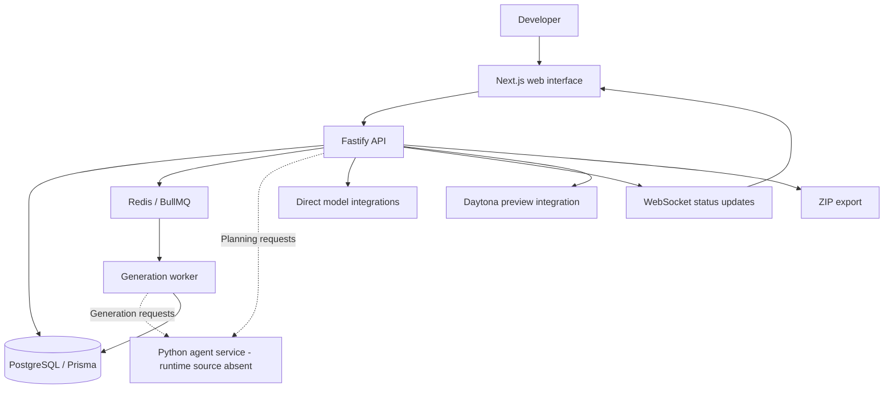

# CraftaStudio

An architecture-first workspace for planning applications, reviewing dependencies, and inspecting AI-generated code.

[](LICENSE)

**Status: early development.** The public checkout contains the web interface, API, and generation integrations, but complete end-to-end generation has not been verified. The Python agent runtime source is absent from this checkout. Security improvements are in progress; this is not a production-ready release.

## Why CraftaStudio?

Generating application components independently can leave gaps between data models, API contracts, and user interfaces. CraftaStudio puts an editable architecture between the initial prompt and code generation so those dependencies can be reviewed first.

The project is building a workflow in which plans, blocks, project memory, and generated outputs share context. Generated code still needs human review and validation.

## Product workflow

1. **Describe the application.** Start a project with a natural-language prompt.
2. **Review the plan.** Request clarifying questions and a project document, then refine the proposed architecture on the canvas.
3. **Review blocks and dependencies.** Inspect the proposed components and connections before approving generation.
4. **Generate and inspect code.** Follow run and block status, review outputs, and request changes.
5. **Preview or export.** Use the preview and ZIP export paths when the required services and generated outputs are available.

This describes the workflow represented in the frontend and backend. It is not a claim that the entire sequence currently succeeds from a fresh clone.

## Capabilities and current limits

| Area | Present in the public source | Current limit |
| --- | --- | --- |
| Architecture canvas | React Flow blocks, connections, plan editing, and graph utilities | Planning depends on the agent service; a complete planning run is unverified. |
| Project context | PostgreSQL records for projects, documents, runs, and memory; shared block/context type definitions | Consistency across a complete generated application is unverified. |
| Code generation | Approval routes, generation handlers, BullMQ worker code, and status updates | Agent calls require runtime source that is missing from this checkout. |
| Output review | Code viewer, run history, preview components, and ZIP export routes | Preview needs additional services; generated exports have not been verified as runnable applications. |

The merge route is present, but the queue worker currently skips merge jobs. Do not assume that a final application assembly step is complete.

## Architecture



The diagram follows the checked-in integration points. Agent internals and a successful end-to-end run cannot be established from this checkout. Shared block and context definitions are in [`shared/types/blocks.ts`](shared/types/blocks.ts).

## Technology stack

| Layer | Technologies visible in the repository |
| --- | --- |
| Web interface | Next.js **16.2.3**, React **19.2.4**, TypeScript, React Flow (`@xyflow/react`), Tailwind CSS 4 |
| API | Fastify 5, TypeScript, Zod, Clerk integration, WebSockets |
| Data and jobs | PostgreSQL, Prisma, Redis, BullMQ |
| AI and previews | Anthropic SDK, additional model-provider integrations, Langfuse, Daytona, Sandpack |
| Agent dependencies | FastAPI, Uvicorn, LangGraph, Pydantic, and model SDKs declared in [`agents/requirements.txt`](agents/requirements.txt); Python implementation source is missing |

Root, frontend, and backend have separate npm manifests and lockfiles. No Node.js engine or npm version is pinned in those manifests.

## Local development

**Setup status: partially documented, not verified end to end.** The commands below exist in the checkout, but a clean dependency installation, migrations, builds, and service startup have not been validated for the public checkout. Obtain the missing agent runtime and current development configuration from the maintainers before attempting the complete product workflow.

### Requirements

- **Git and npm.** npm is used by the repository scripts; no package-manager version is pinned.
- **Node.js 22.12 or later** for the current combined dependency tree: the locked backend Puppeteer package declares this minimum. Next.js alone declares Node.js 20.9 or later. The backend Dockerfile still uses Node.js 20, so a working container build is not established here.
- **PostgreSQL and Redis** for API persistence and queue processing. The contribution handbook lists PostgreSQL 15+ and Redis 7+; those versions have not been validated against a clean local run.
- **Python 3.11** is the agent Dockerfile baseline. A Python interpreter and installed dependencies do not replace the missing agent source.
- **Development service accounts and credentials**, including Clerk and the integrations used by the feature being developed. Use isolated development resources.

### 1. Get the source

```bash
git clone https://github.com/Craftastudio-ai/CraftaStudio.git
cd CraftaStudio
```

For a contribution, create a GitHub fork of the official repository and clone your fork instead; keep the organization repository as `upstream`.

### 2. Prepare development configuration

No `.env.example` is tracked in this checkout. Ask the maintainers for a complete development configuration and create the files below locally using development credentials.

The following is a source-derived starting point, **not a complete or tested environment template**:

| Location | Configuration to prepare |
| --- | --- |
| `frontend/.env.local` | Clerk development configuration; set `BACKEND_URL=http://localhost:3001` and `NEXT_PUBLIC_API_URL=http://localhost:3001` to use the local API. |
| `backend/.env` | `DATABASE_URL` for a disposable local PostgreSQL database, `REDIS_URL` for local Redis, `CLERK_SECRET_KEY`, and `AGENT_SERVICE_URL=http://localhost:8000` when a local agent service is available. |
| Feature-specific configuration | Model credentials such as `ANTHROPIC_API_KEY`, Langfuse configuration, and `DAYTONA_API_KEY` depend on the paths being exercised. The missing Python runtime's configuration cannot be verified here. |

Backend scripts load environment settings from their working directory. Frontend proxy routes and browser requests use separate URL settings, so configure both frontend API URLs explicitly. Keep secret values out of browser-exposed variables, source files, and commits.

### 3. Install the components you need

To install the JavaScript components from their lockfiles, use the commands below. **Installation has not been tested**:

```bash
npm --prefix frontend ci
npm --prefix backend ci
```

Backend installation runs Prisma client generation through its `postinstall` script. Successful installation alone does not establish that the application can start.

The root `npm install` also runs `install:all` through `postinstall`, installing frontend, backend, and Python dependencies. `npm run install:all` creates `agents/.venv` and installs Python requirements, but it cannot restore missing Python source files.

### 4. Prepare the local database and start JavaScript services

With the development environment configured and PostgreSQL and Redis running, the repository provides these commands. **Migrations and startup remain unverified.** Apply migrations only to a disposable development database.

```bash
npm --prefix backend run prisma:migrate
```

Then start each service in a separate terminal:

```bash
npm --prefix backend run dev
```

```bash
npm --prefix frontend run dev
```

| Service | Configured development address | Notes |
| --- | --- | --- |
| Web interface | `http://localhost:3010` | Port is set in the frontend `dev` script. |
| API | `http://localhost:3001` | Default in `backend/src/server.ts`; configurable with `PORT`. |
| Agent service | `http://localhost:8000` | Target of the development launcher; runtime source is missing. |

The root `npm run dev` attempts to launch all three services. Its Python launcher requires `agents/main.py`, which is absent, so it is not a working full-stack quick start for this public checkout. Starting the JavaScript services separately does not enable agent-dependent features.

### Available checks and build commands

Run these from the repository root after installing the relevant component dependencies:

| Command | Defined behavior |
| --- | --- |
| `npm --prefix frontend run lint` | Runs ESLint. |
| `npm --prefix backend run type-check` | Runs the backend TypeScript check. |
| `npm run build` | Builds frontend, then backend; backend build generates its Prisma client. |

The root `npm run type-check` exists, but calls a frontend `type-check` script that is not defined. There is no npm `test` script in the root, frontend, or backend manifests. A graph test file exists under [`backend/tests/`](backend/tests/), but a configured, working test runner has not been verified. No successful test or build result is claimed here.

## Project structure

```text
CraftaStudio/
├── frontend/       Next.js app, canvas, code review, and preview UI
├── backend/
│   ├── src/        API routes, graph logic, memory, queue worker, integrations
│   ├── prisma/     PostgreSQL schema and migrations
│   └── tests/      Graph test source
├── agents/         Prompts, requirements, schemas, and Dockerfile; runtime absent
├── shared/         Block and shared-context type definitions
├── scripts/        Python dependency installer and development launcher
├── CONTRIBUTING.md Contribution guidelines
└── LICENSE         MIT license
```

## Contributing

Read [`CONTRIBUTING.md`](CONTRIBUTING.md) before starting an issue. Keep each change focused, use conventional commits, and agree on shared-contract changes before editing `shared/`.

**Branch policy needs clarification:** the handbook requires branches and PRs to use `dev`, but the official repository currently publishes only `main`, which is also its default branch. Confirm the intended base and PR target with a maintainer. Until that is resolved, `upstream/main` is the available technical baseline; do not work directly on `main` or create a replacement company branch yourself.

Use an issue branch such as `docs/<description>`, `fix/<issue>-<description>`, or `feature/<issue>-<description>` in your fork. Include the scope, verification performed, and any checks that could not be run in the PR description. The handbook's root type-check requirement is subject to the tooling gap described above.

## Security

Security improvements are in progress. Use development credentials and isolated resources, and review generated code before running it or granting it access to data or services.

This checkout does not include a `SECURITY.md` or a documented private reporting address. Contact a maintainer privately to agree on a reporting channel before sharing sensitive vulnerability details. Do not include credentials or sensitive reproduction details in public issues.

## Roadmap

Proposed priorities based on the current public checkout; maintainers have not confirmed a release schedule:

- Make the agent runtime available and document a reproducible local setup.
- Verify the full prompt-to-plan-to-generation-to-preview/export workflow.
- Complete and validate application assembly behavior.
- Align contributor branch policy, environment documentation, and check commands with the repository.
- Continue security improvements and establish a private reporting policy.

## Maintainers and project team

The existing project documentation credits Pranav Gawai, Vedant Kirange, Jayesh Chaudhari, Sanika Patil, and Atharva Jadhav. Confirm current review ownership through the [official repository](https://github.com/Craftastudio-ai/CraftaStudio).

## License

CraftaStudio is distributed under the [MIT License](LICENSE).
